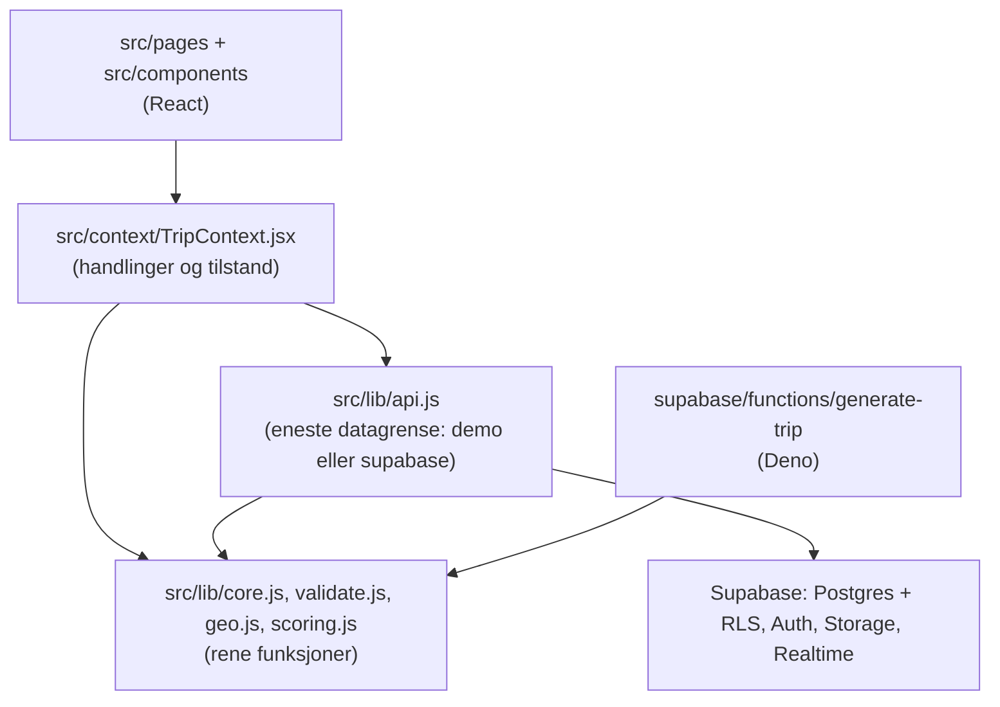
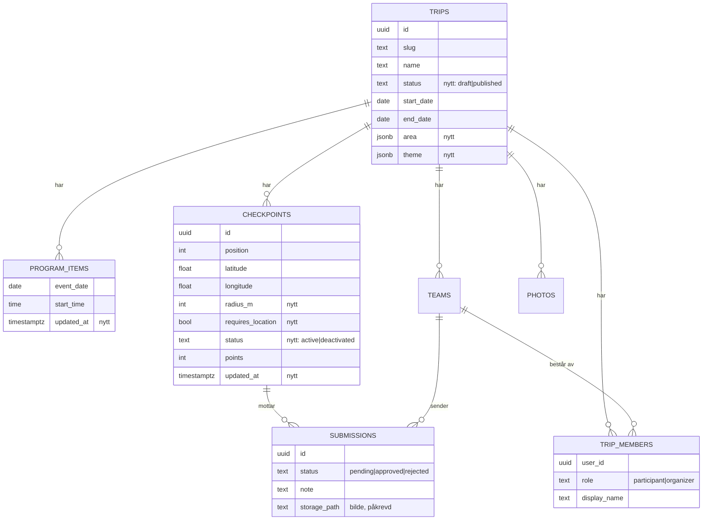
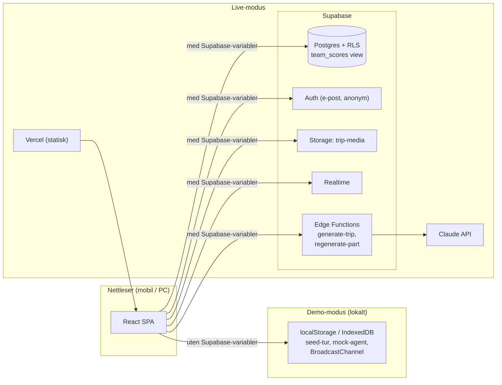

# Architecture Spine: TripBuilder AI

## Design Paradigm

**Revidert 2026-11-24.** Appen bygger på blåtur-malen (flyttet til repo-roten i Story 1.1) og beholder malens struktur: sidekomponentene i `src/pages/` viser tilstand og kaller handlinger, sentrale handlinger ligger i `src/context/TripContext.jsx`, og alle databasekall ligger i `src/lib/api.js`. Regler som validering, avstand og poeng ligger i rene funksjoner uten avhengigheter til React, Supabase eller nettleser-API-er (`src/lib/core.js` og nye filer ved siden av). Appen er **én app** med tre områder: *generator* (arrangøren beskriver en tur og får et utkast), *arrangør* (redigerer, publiserer, godkjenner) og *deltaker* (program, rebus, ledertavle, bilder). Hvert område har egne ruter, og alle bruker samme database.



Pilene viser hva som får lov å importere hva. Rene filer i `src/lib/` importerer bare hverandre. Sidene kaller aldri `supabase` direkte.

## Invariants & Rules

### AD-1: Ren domenekjerne

- **Binds:** all
- **Prevents:** at validering, avstandsregning og poengregning implementeres forskjellig i klient, demo og Edge Function.
- **Rule:** Skjemaregler (`validate.js`), avstand (`geo.js`), poeng (`scoring.js`) og de eksisterende hjelpefunksjonene i `core.js` er rene JavaScript-moduler (ESM). De importerer bare hverandre, har ingen sideeffekter og ingen avhengigheter utenom språket. Edge Function importerer de samme filene. De testes med `node:test` i `tests/`.

### AD-2: TripDraft er den eneste kontrakten for turinnhold [ADOPTED]

- **Binds:** FR-2, FR-3, FR-4, FR-5, FR-11, FR-12
- **Prevents:** at KI-output, seed-data og redigert innhold får ulike former.
- **Rule:** All turdata som går mellom KI og app, er en `TripDraft` (JSON med turens felt, `program_items`, `checkpoints` og `teams`), beskrevet med JSDoc-typer i `validate.js` og kontrollert av `validateTrip(draft, req?)`, som er skrevet for hånd uten bibliotek. Reglene er: alle påkrevde felt er fylt ut, hver dato i perioden har minst én programpost, og ingen programpost ligger utenfor perioden. Poster har koordinater innenfor turens område, `radius_m` er større enn 0, og poengene er heltall større enn 0. Den samme funksjonen kjøres på (a) KI-svar, (b) seed-turen i en test og (c) i klienten før hver lagring, også publisering og endringer underveis. Siden skriving går direkte mot databasen (AD-17), er klientvalideringen en brukerhjelp, mens `CHECK`-begrensningene i databasen er det harde vernet.

### AD-3: Validering med ett nytt forsøk [ADOPTED]

- **Binds:** FR-2, PRD §8.5
- **Prevents:** uendelige løkker, og at et ugyldig utkast blir vist.
- **Rule:** Edge Function `generate-trip` kaller Claude, validerer svaret, og ved feil gjør den nøyaktig ett nytt kall der valideringsfeilene er med i prompten. Feiler også det, returneres `{ ok: false, error: { code: "VALIDATION_FAILED", issues } }`. Det finnes ikke noe KI-basert QA-steg i V1.

### AD-4: Valg av modus skjer ett sted [ADOPTED]

- **Binds:** FR-11, FR-12
- **Prevents:** at demo-logikk sprer seg som `if (demo)` i komponentene.
- **Rule:** Modus avgjøres av om `VITE_SUPABASE_URL` og `VITE_SUPABASE_PUBLISHABLE_KEY` er satt, og dette leses bare i `src/lib/supabase.js`. Alle datakall går gjennom `src/lib/api.js`, som har en demo-implementasjon (localStorage, mock-agent, simulert posisjon, `BroadcastChannel`) og en Supabase-implementasjon bak samme funksjonsnavn. Komponentene kjenner ikke modus, bortsett fra demo-banneret. Demo-modus skal starte med `npm install && npm run dev` uten noen miljøvariabler.

### AD-5: Poeng avledes fra godkjente innsendinger og postens gjeldende poeng [ADOPTED]

- **Binds:** FR-8, FR-9, FR-10, FR-15, FR-17
- **Prevents:** at poengsummen kommer ut av synk med innsendingene, og at lag som har løst samme post, får ulike poeng.
- **Rule:** Lagets poeng er summen av gjeldende `checkpoints.points` for poster der laget har en godkjent innsending. Hvert par av lag og post har maks én aktiv innsending, sikret med malens unike delindeks på `(team_id, checkpoint_id)` der `status in ('pending','approved')`, så en post teller maks én gang per lag. Det finnes ingen kolonne for poeng per lag eller per innsending. Endrer arrangøren poengene på en post, eller regenereres posten, gjelder de nye poengene for alle lag som har løst den, også tidligere godkjenninger. En deaktivert post teller fortsatt for lag som har løst den. I live-modus regner viewet `team_scores` ut summen (nytt, malen regner i klienten), og i demo-modus gjør `scoring.js` det. Begge testes mot de samme testtilfellene.

### AD-6: Opplåsing ved posisjon skjer i klienten [ADOPTED]

- **Binds:** FR-5, FR-6
- **Prevents:** at posisjon lagres eller sendes (personvern), og at opplåsing ikke kan testes uten å gå ut i felt.
- **Rule:** En post med `requires_location = false` er alltid åpen. En geolåst post er opplåst når `distanceMeters(pos, post) <= post.radius_m` (haversine i `geo.js`). Posisjonen kommer fra nettleserens geolokasjon eller en simulert posisjon (demo og tester). Posisjonen sendes aldri til serveren og lagres aldri. Integriteten sikres ved at arrangøren godkjenner innsendingen (AD-7), ikke ved at serveren sjekker posisjonen. Gruppen aksepterer risikoen for at en deltaker jukser med posisjonen. **Avklart 2026-11-24:** Setningen i malens README om at GPS «senere må valideres på serveren» gjelder ikke, og README rettes.

### AD-7: Innsendinger har livsløpet ventende → godkjent eller avvist [ADOPTED, revidert 2026-11-24]

- **Binds:** FR-7, FR-15, PRD §8.3
- **Prevents:** at poeng gis før godkjenning, eller at deltakere kan endre statusen selv.
- **Rule:** `submission.status ∈ {pending, approved, rejected}`. Deltakeren kan bare opprette en innsending med status `pending` for sitt eget lag (malens `submissions_insert`). **Besluttet 2026-11-24:** hver innsending har alltid et bilde (påkrevd, som i malens migrasjon `202610280002`) og et kort notat (3 til 1000 tegn, `note`). Det finnes ingen svartyper. Bare arrangøren av turen kan endre `status`, og det skjer gjennom malens RLS-regel for oppdatering, ikke gjennom en egen RPC (`review_submission` utgår, jf. AD-17). Avviste innsendinger kan sendes inn på nytt som en ny rad. «Angre» i UI er en forsinket sending (5 s) og krever ingen omgjøring på serveren.

### AD-8: Identitet og tilgang [ADOPTED]

- **Binds:** FR-13, FR-14
- **Prevents:** at deltakere ser andre turer eller kan redigere.
- **Rule:** Arrangøren logger inn med e-post og magisk lenke i Supabase Auth. Deltakeren får en anonym Supabase-innlogging og blir koblet til turen via RPC-en `join_trip(p_slug, p_code, p_name)`, som oppretter en `trip_members`-rad med rollen `participant`. Arrangøren som oppretter en tur, får en `trip_members`-rad med rollen `organizer` (ikke en egen `organizer_id`-kolonne). En bruker kan være medlem av flere turer, og appen henter turen fra slug eller id i adressen, aldri bare første medlemskap. All tilgang håndheves med RLS. Klienten stoler aldri på roller den har avgjort selv.

### AD-9: KI-nøkler finnes bare på serveren [ADOPTED]

- **Binds:** FR-2, FR-3
- **Prevents:** at API-nøkkelen lekker i klientkoden.
- **Rule:** Kall til Claude skjer bare i `supabase/functions/` (`generate-trip`, og `regenerate-part` i trinn E). Nøkkelen er en Supabase-secret. Serverhemmeligheter som `ANTHROPIC_API_KEY` settes bare med `supabase secrets set` og leses bare i Edge Functions. De har aldri `VITE_`-prefiks, står aldri med verdi i `.env.example`, og produksjonsbygget av frontenden skal ikke inneholde dem. Klienten kaller KI-en bare gjennom `api.generateTrip()`. I demo-modus er dette en mock som returnerer seed-turen.

### AD-10: Sanntid betyr «hent på nytt ved signal»

- **Binds:** FR-9, FR-10, SM-5
- **Prevents:** at ledertavlen viser ulike tall hos ulike klienter.
- **Rule:** Realtime gir bare et signal. Klienten henter da turen og poengene på nytt fra kilden (`team_scores` eller `scoring.js`). Data i hendelsen brukes aldri til å oppdatere poengene direkte. Live-modus bruker Supabase Realtime (`postgres_changes`) på `submissions` og `checkpoints`, slik malen allerede gjør i `TripContext.jsx`. Demo-modus bruker `BroadcastChannel` mellom faner.

### AD-11: Bilder ligger i en privat bucket

- **Binds:** FR-7
- **Prevents:** at bilder blir offentlig tilgjengelige, og at stiene blir inkonsistente.
- **Rule:** Bildene lagres i den private bucketen `trip-media` med stien `{trip_id}/{user_id}/…`, slik malen gjør. De komprimeres i klienten, og bucketen har en filstørrelsesgrense. De leses via signerte URL-er, hentet samlet med `createSignedUrls`. Tilgangsreglene for Storage følger samme medlemskapslogikk som AD-8. I demo-modus lagres bildene som data-URL i nettleseren.

### AD-12: Regenerering bytter ut ett element

- **Binds:** FR-3, FR-17, UJ-2 (trinn E)
- **Prevents:** at regenerering skriver over arrangørens andre endringer.
- **Rule:** `regenerate-part` får hele turen og `{ kind: "day" | "post" | "program_item" | "new_post" | "new_program_item", id?, instruction }`. For eksisterende elementer returnerer den bare det nye elementet med samme `id`. For `new_*` returnerer den ett nytt element. Klienten slår det sammen og kjører `validateTrip()` på hele turen. Et ugyldig resultat vises aldri som akseptert. Dette gjelder også publiserte turer, og der går forslaget først live når arrangøren har godkjent det (AD-13). `day` betyr alle programposter med samme `event_date`.

### AD-13: En publisert tur kan endres, men poster med innsendinger deaktiveres i stedet for å slettes [ADOPTED]

- **Binds:** FR-4, FR-17
- **Prevents:** at innsendinger og poeng blir koblet til poster som ikke finnes lenger.
- **Rule:** En publisert tur redigeres med de samme `api.js`-funksjonene som et utkast (AD-17). `checkpoints.status ∈ {active, deactivated}`. En post med innsendinger kan bare få status `deactivated`, aldri slettes. Databasen håndhever dette med fremmednøkkelen fra `submissions` til `checkpoints` uten `ON DELETE CASCADE` (`ON DELETE RESTRICT`), og en RLS-regel eller trigger som nekter sletting av poster med innsendinger. En deaktivert post avviser nye innsendinger, men godkjente innsendinger teller fortsatt i `team_scores` (AD-5). `program_items` og `checkpoints` har `updated_at`, som settes av en trigger ved hver endring. Malen mangler `status` og `updated_at`, og de legges til i nye migrasjoner.

### AD-14: Temaet er data, ikke stil `[ADOPTED]`

- **Binds:** FR-16
- **Prevents:** at KI-en produserer vilkårlig CSS eller farger som bryter kontrastkravene.
- **Rule:** `trip.theme = { accent: ThemeAccent, icon: ThemeIcon }`, der begge er faste verdier definert i `validate.js`. Hver aksentfarge er forhåndsgodkjent for 4.5:1 kontrast i DESIGN.md. Temaet gjelder ved at appen setter CSS-variabler (`--accent` m.fl.) på toppelementet ut fra den faste listen, og fargene i `styles.css` er variabler. Temaet påvirker bare toppen og aksentene på deltakersiden. Ugyldig tema faller tilbake til standardtemaet.

### AD-15: TripRequest er input-kontrakten for generering [ADOPTED]

- **Binds:** FR-1, FR-2
- **Prevents:** at KI-en gjetter periode og antall, og at mock og Edge Function får ulik input.
- **Rule:** `api.generateTrip(req)`, der `req = { destination, start_date, end_date, participant_count, team_count?, post_count?, description }` er beskrevet og kontrollert i `validate.js`. `validateTrip(draft, req)` sjekker i tillegg at utkastets periode er lik `start_date` og `end_date`, at antall lag er lik `team_count`, og at antall aktive poster er lik `post_count`, når de er oppgitt.

### AD-16: Endringer i turen sendes ut som «hent på nytt»-signal [ADOPTED]

- **Binds:** FR-18
- **Prevents:** at deltakere ser utdatert program, og at merket «Endret» blir beregnet forskjellig.
- **Rule:** Realtime-abonnementet fra AD-10 dekker også `program_items`, `checkpoints` og `trips`, og klienten henter turen på nytt. Sett-status lagres lokalt på enheten per element: `seen[element_id]` er den `updated_at` elementet hadde da deltakeren sist så det, og `baseline_at` er tidspunktet for deltakerens første innlasting av turen. Et element er «Endret» når `updated_at` er nyere enn både `baseline_at` og `seen[element_id]`. Å åpne et element markerer bare det elementet som sett. «Merk alle som sett» markerer elementene som var endret i det øyeblikket, og endringer som kommer etterpå, forblir uleste.

### AD-17: Turstruktur lagres direkte mot databasen, vernet av RLS og CHECK [ADOPTED, revidert 2026-11-24]

- **Binds:** FR-2, FR-3, FR-4, FR-17
- **Prevents:** at deltakere eller andre arrangører endrer en tur, og at åpenbart ugyldige verdier havner i databasen.
- **Rule:** Gruppen har besluttet å beholde malens modell: klienten skriver til turtabellene med supabase-js, og RLS bestemmer hvem som får det. Bare arrangøren av turen kan sette inn, endre og slette `program_items`, `checkpoints` og `teams`, og endre `trips`. Deltakere har bare lesetilgang, bortsett fra egne innsendinger (AD-7). `CHECK`-begrensninger i databasen (`radius_m > 0`, `points` mellom 0 og 500, gyldige statusverdier, gyldig datoperiode) er det harde vernet. `validateTrip()` kjøres i klienten før lagring, og `generate-trip` validerer før den returnerer et utkast. Edge Function `save-trip`, `apply_trip_change` og `trips.version` finnes ikke.
- **Akseptert risiko:** Et direkte API-kall fra arrangøren selv kan lagre en tur som bryter reglene i `validateTrip()` men ikke `CHECK`-begrensningene, for eksempel en post utenfor området. Skaden rammer bare arrangørens egen tur, og ingen andre kan skrive til den. Publisering er en oppdatering av `trips.status` og valideres bare i klienten. To enheter som lagrer samtidig, overskriver hverandre (siste skriving vinner), og sanntidssignalet (AD-16) gjør at begge ser resultatet.

## Consistency Conventions

| Område | Konvensjon |
| --- | --- |
| Navngiving | Databasetabeller og -kolonner i `snake_case` i flertall (`checkpoints`, `team_id`). Domenefelt i JavaScript holdes i `snake_case`, likt med databasen, så det ikke trengs noen mapping. Tabellnavn følger malen: `trips`, `teams`, `trip_members`, `program_items`, `checkpoints`, `submissions`, `photos`. React-komponenter i `PascalCase.jsx`. Alle databasekall ligger i `src/lib/api.js` |
| ID-er | Alle ID-er er UUID v4 og genereres av klienten (`crypto.randomUUID()`), også i KI-output, der Edge Function fyller inn manglende ID-er før validering |
| Datoer og tid | Datoer som `YYYY-MM-DD`, klokkeslett som `HH:mm` (lokal tid for turen), tidsstempler som ISO 8601 UTC |
| Koordinater | `{ lat, lng }` i desimalgrader (WGS84). Avstander i meter som heltall |
| Turens område | `area = { center: {lat,lng}, radius_m }`. «Innenfor området» betyr at avstanden fra `center` er mindre enn eller lik `radius_m`. Området foreslås av KI-en ut fra destinasjonen og kan flyttes og endres av arrangøren i Utkast |
| Feil | `api.js` og Edge Functions returnerer `{ ok: true, data } | { ok: false, error: { code, message, issues? } }`. Koder skrives i `UPPER_SNAKE`. UI oversetter koden til norsk mikrotekst (EXPERIENCE.md) |
| Tilstand | Serverdata hentes og caches via `TripContext` (`useTrip`) og avledede verdier fra `scoring.js`. Det brukes ingen global store til serverdata |
| Konfigurasjon | Bare offentlig klientkonfigurasjon har `VITE_`-prefiks (`VITE_SUPABASE_URL`, `VITE_SUPABASE_PUBLISHABLE_KEY`). Den er dokumentert i `.env.example` og leses bare i `src/lib/supabase.js` (AD-4). Serverhemmeligheter følger AD-9 |
| Tester | Rene funksjoner testes med `node:test` (`tests/*.test.js`, kjøres med `npm test`). Flyter testes manuelt i demo-modus på localhost etter en testprotokoll i README (malens definisjon av ferdig). Det er ingen automatisk nettlesertest og ikke Playwright (besluttet 2026-11-24). Tilgangsregler (RLS, RPC-er og Storage) testes med en live-integrasjonstest med to arrangører og to turer mot et eget Supabase-prosjekt |

## Stack

Fra `package.json`. Versjonene verifiseres mot npm ved oppsett.

| Navn | Versjon |
| --- | --- |
| JavaScript (ESM), vanlig CSS | uten TypeScript og uten Tailwind |
| React | 19.2.x |
| Vite | 8.x (Node 20.19+ eller 22.12+) |
| React Router (`react-router-dom`) | 7.13.x |
| Leaflet / react-leaflet | 1.9.x / 5.0.x |
| @supabase/supabase-js | 2.103.x |
| Supabase CLI | nyeste ved oppsett |
| @anthropic-ai/sdk (i Edge Function) | verifiseres ved oppsett |
| Testing | `node:test` (innebygd i Node) |
| Hosting | Vercel (statisk frontend) og Supabase (database, Auth, Storage, Realtime, Edge Functions) |

Zod, Vitest og Tailwind fra den opprinnelige spinen er tatt ut. Playwright er ikke med (besluttet 2026-11-24): flyten testes manuelt på localhost.


## Structural Seed

### Datamodell (malens tabeller, med tillegg, PRD §8.1)

Malens migrasjoner (`supabase/migrations/`) er utgangspunktet. Kolonner merket «nytt» legges til i nye migrasjoner (aldri ved å endre en migrasjon som er kjørt).



Invitasjonskoden ligger som hash i `private.trip_access` (aldri i en lesbar tabell). `team_scores` er et nytt view (AD-5). Det finnes ingen `days`-tabell: en dag er alle `program_items` med samme `event_date` (AD-2). `TripDraft` er den nøstede formen av `trips`, `program_items`, `checkpoints` og `teams`.

### System og drift



Miljøer: `demo`, som er lokal og standard for sensor, og `live`, som bruker ett Supabase-prosjekt og Vercel. Det finnes ikke noe eget staging-miljø i V1. Databaseendringer ligger i `supabase/migrations/` og er den eneste kilden til skjemaet.

### Kildetre

Tilpasset malen. Nye filer er merket «nytt».

```text
src/
  main.jsx, App.jsx  # ruter for de tre områdene
  pages/             # Home, Program, Rebus, Gallery, Admin (finnes) + Generator, MineTurer (nytt)
  components/        # Shell m.fl.
  context/TripContext.jsx  # handlinger og tilstand (hent tur fra slug/id)
  lib/
    api.js           # eneste datagrense (demo og supabase)
    supabase.js      # leser VITE_SUPABASE_*, avgjør modus
    core.js          # rene hjelpefunksjoner (finnes)
    validate.js      # nytt: validateTrip, TripRequest, tema-lister
    geo.js           # nytt: distanceMeters (haversine)
    scoring.js       # nytt: lagpoeng
  data/demo.js       # seed-tur
tests/*.test.js      # node:test
supabase/
  migrations/        # malens to, pluss nye
  functions/generate-trip/, functions/regenerate-part/
```


## Capability → Architecture Map

| Krav | Ligger i | Styres av |
| --- | --- | --- |
| FR-1, FR-2 Prompt og generering | `pages/Generator`, `api.generateTrip`, `functions/generate-trip` | AD-2, AD-3, AD-9 |
| FR-3 Redigering og regenerering | `pages/Admin`, `functions/regenerate-part` | AD-2, AD-12 |
| FR-4 Publisering | `api` (oppdaterer `trips.status`) | AD-2, AD-13, AD-17 |
| FR-5, FR-6 Poster og opplåsing | `lib/geo.js`, posisjonskilde i klienten | AD-6 |
| FR-7, FR-15 Innsending og godkjenning | `pages/Rebus`, `pages/Admin`, Storage `trip-media` | AD-7, AD-11 |
| FR-8, FR-9, FR-10 Lag, poeng og ledertavle | `lib/scoring.js`, `team_scores`, Realtime | AD-5, AD-10 |
| FR-17, FR-18 Endringer underveis | `pages/Admin` (redigering av publisert tur), Realtime | AD-12, AD-13, AD-16, AD-17 |
| FR-16 Tema | `lib/validate.js`, CSS-variabler, designsteget i `generate-trip` | AD-14 |
| FR-11, FR-12 Demo og mock | demo-modus i `api.js`, `data/demo.js` | AD-4 |
| FR-13, FR-14 Tilgang | Supabase Auth, RLS, `join_trip` | AD-8 |


## Deferred

- **Blåtur-malen:** Lastet opp som `template_trip/` og innarbeidet i denne revisjonen (2026-11-24). Flyttet til repo-roten i Story 1.1 (`src/`, `tests/`, `supabase/`). Malens stakk er beholdt, RLS er godtatt (AD-17), og det er én app. Gjenstår: navigasjonsmønster og farger i UX avgjøres ut fra malens skall, og malen må gjøres datadrevet (fjern slug `blatur-2026`, tittel og datoer i `Welcome.jsx` og `Shell.jsx`). Malens egen `AGENTS.md` og README, som sier «én tur» og «ikke generatoren», må oppdateres ved oppstart.
- **Eget Supabase-prosjekt:** Malen skal ha et nytt prosjekt. Det eksisterende prosjektet «CharterFeber AI» har et annet skjema (`trips.title`, `private.trip_secrets`) og brukes ikke før skjemaene er samordnet.
- **Tilgangsgaranti uten server (AD-17):** Publisering og strukturregler valideres bare i klienten. Vurder en databasetrigger som krever gyldige poster og programposter ved `status = published`, hvis tiden tillater det.
- **Personvern for bilder:** Samtykke, lagringstid og sletting av bilder avklares før Epic 4 (PRD §8.6). AD-11 og AD-8 gir tilgangskontrollen, men ikke svaret på disse spørsmålene.
- **Skjult destinasjon:** Utenfor V1.
- **Testoppsett for sanntid (PRD §8.4):** Mekanismen er bestemt (AD-10). Hvordan den testes og vises på eksamen, avgjøres før trinn C.
- **Lagtildeling:** Om arrangøren fordeler deltakerne eller deltakerne velger selv (åpent punkt i UX). Det påvirker bare UI og én RLS-regel, og avgjøres i stories for trinn C.
- **Generering i bakgrunnen:** I V1 må siden være åpen til utkastet er klart. Jobbstatus som overlever at siden lukkes, kan komme senere.
- **Køing uten nett:** Om innsendinger kan sendes uten dekning. Det kan legges til i `api.js` uten å endre kontraktene.
- **Hvilken Claude-modell og hvilken prompt:** Dette er detaljer inne i Edge Function. Det velges når A.3 implementeres, med tanke på kostnad.
- **KI-basert QA og OpenAI:** Utenfor V1 (PRD §8.5).
- **Overvåking og logging i drift:** Supabase og Vercel sine standardlogger holder for V1.
- **Ytelsesbudsjett for kart og bilder utover SM-7:** Måles i fase 2.
