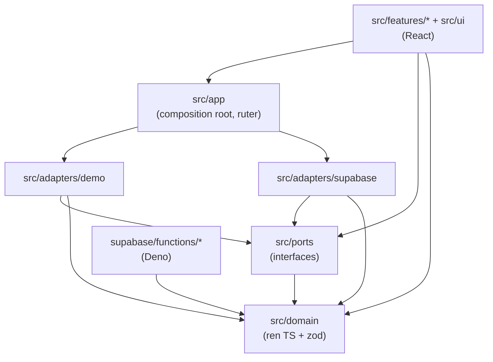
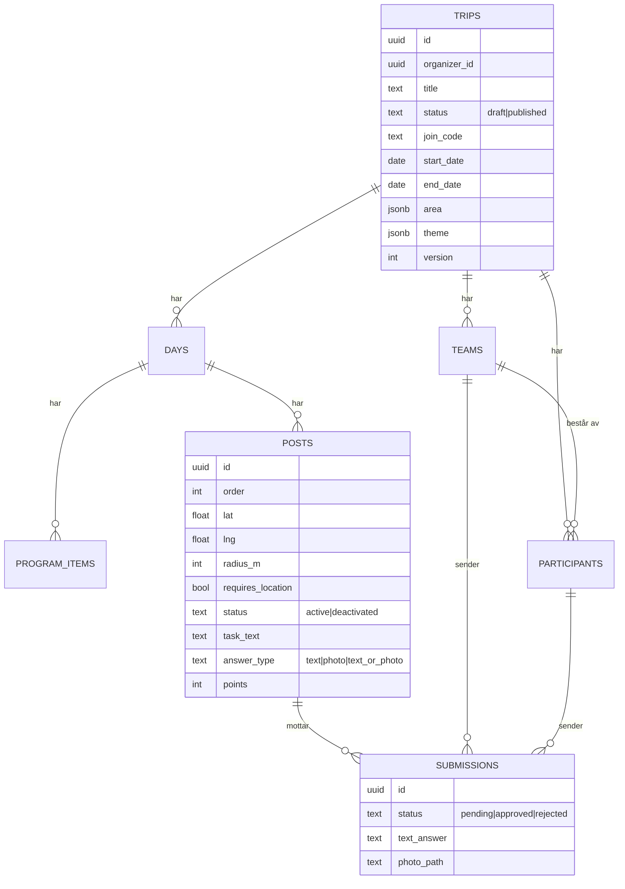
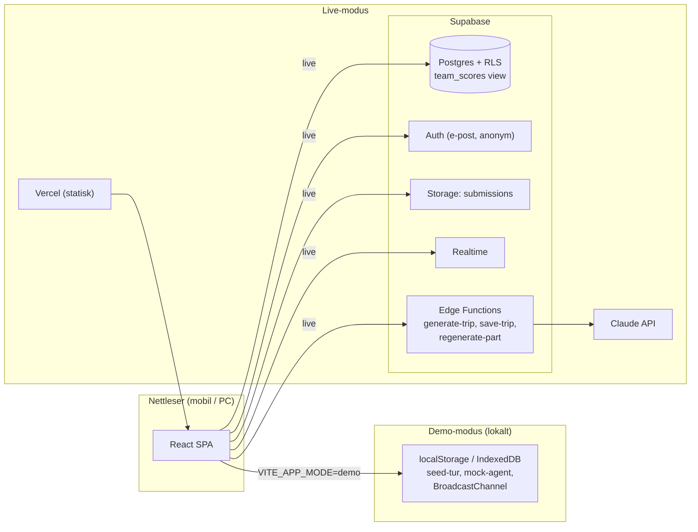

# Architecture Spine: TripBuilder AI

## Design Paradigm

Arkitekturen er **ports & adapters**. En ren domenekjerne inneholder skjema, validering, geo og poeng. Den har ingen avhengigheter til React, Supabase eller nettleser-API-er. Appen snakker med omverdenen bare gjennom porter, og hver port har to adaptere: `demo`, som er lokal og uten nøkler, og `supabase`, som er ekte modus. Hvilken adapter som brukes, velges ett sted (composition root).



Pilene viser hva som får lov å importere hva. `src/domain` importerer bare `zod`. UI-koden importerer aldri en adapter direkte.

## Invariants & Rules

### AD-1: Ren domenekjerne

- **Binds:** all
- **Prevents:** at validering, avstandsregning og poengregning implementeres forskjellig i klient, demo og Edge Function.
- **Rule:** `src/domain/` inneholder skjema (`schema.ts`), regelvalidering (`validate.ts`), avstand (`geo.ts`) og poeng (`scoring.ts`). Filene importerer bare `zod` og hverandre, og de har ingen sideeffekter. Edge Functions importerer de samme filene via et import-kart i `deno.json`.

### AD-2: TripDraft-skjemaet er den eneste kontrakten for turinnhold [ADOPTED]

- **Binds:** FR-2, FR-3, FR-4, FR-5, FR-11, FR-12
- **Prevents:** at KI-output, seed-data og redigert innhold får ulike former.
- **Rule:** All turdata som går mellom KI og app, er en `TripDraft` som valideres av `validateTrip()` (zod-skjema og regler). Reglene er: hver dato i perioden har nøyaktig én dag, og ingen dag ligger utenfor perioden. Hver dag har minst én programpost. Poster har koordinater innenfor turens område, `radius_m` er større enn 0, poengene er positive heltall, og alle påkrevde felt er fylt ut. Den samme funksjonen kjøres på (a) KI-svar, (b) seed-turen i en test og (c) før hver lagring, også publisering og endringer underveis (AD-17).

### AD-3: Validering med ett nytt forsøk [ADOPTED]

- **Binds:** FR-2, PRD §8.5
- **Prevents:** uendelige løkker, og at et ugyldig utkast blir vist.
- **Rule:** Edge Function `generate-trip` kaller Claude, validerer svaret, og ved feil gjør den nøyaktig ett nytt kall der valideringsfeilene er med i prompten. Feiler også det, returneres `{ ok: false, error: { code: "VALIDATION_FAILED", issues } }`. Det finnes ikke noe KI-basert QA-steg i V1.

### AD-4: Valg av modus skjer bare i composition root [ADOPTED]

- **Binds:** FR-11, FR-12
- **Prevents:** at demo-logikk sprer seg som `if (demo)` i komponentene.
- **Rule:** `VITE_APP_MODE=demo|live` leses bare i `src/app/services.ts`, som bygger porteobjektet (`TripRepo`, `AgentPort`, `AuthPort`, `RealtimePort`, `StoragePort`, `PositionSource`). Komponentene henter tjenestene via `useServices()`. Det eneste unntaket er `useMode()`, som brukes av demo-banneret og posisjonssimulatoren. Demo-modus skal starte med `npm install && npm run dev` uten noen miljøvariabler.

### AD-5: Poeng avledes fra godkjente innsendinger og postens gjeldende poeng [ADOPTED]

- **Binds:** FR-8, FR-9, FR-10, FR-15, FR-17
- **Prevents:** at poengsummen kommer ut av synk med innsendingene, og at lag som har løst samme post, får ulike poeng.
- **Rule:** Lagets poeng er summen av gjeldende `post.points` for poster der laget har en godkjent innsending. Hvert par av lag og post teller maks én gang, sikret med en unik delindeks på `(team_id, post_id)` der `status = approved`. Det finnes ingen kolonne for poeng per lag eller per innsending. Endrer arrangøren poengene på en post, eller regenereres posten, gjelder de nye poengene for alle lag som har løst den, også tidligere godkjenninger. En deaktivert post teller fortsatt for lag som har løst den. I live-modus regner viewet `team_scores` ut summen, og i demo-modus gjør `scoring.ts` det. Begge testes mot de samme testtilfellene.

### AD-6: Opplåsing ved posisjon skjer i klienten [ADOPTED]

- **Binds:** FR-5, FR-6
- **Prevents:** at posisjon lagres eller sendes (personvern), og at opplåsing ikke kan testes uten å gå ut i felt.
- **Rule:** En post med `requires_location = false` er alltid åpen. En geolåst post er opplåst når `distanceMeters(pos, post) <= post.radius_m` (haversine i `geo.ts`). Posisjonen kommer fra `PositionSource`, som enten er nettleserens geolokasjon eller en simulert posisjon (demo og tester). Posisjonen sendes aldri til serveren og lagres aldri. Integriteten sikres ved at arrangøren godkjenner innsendingen (AD-7), ikke ved at serveren sjekker posisjonen. Gruppen aksepterer risikoen for at en deltaker jukser med posisjonen.

### AD-7: Innsendinger har livsløpet ventende → godkjent eller avvist [ADOPTED]

- **Binds:** FR-7, FR-15, PRD §8.3
- **Prevents:** at poeng gis før godkjenning, eller at deltakere kan endre statusen selv.
- **Rule:** `submission.status ∈ {pending, approved, rejected}`. Deltakeren kan bare opprette en innsending med status `pending` for sitt eget lag. Bare arrangøren av turen kan endre `status`, og det skjer via RPC-en `review_submission(id, decision, reason?)`. Avviste innsendinger kan sendes inn på nytt som en ny rad. `review_submission` er idempotent: samme beslutning to ganger endrer ingenting. «Angre» i UI er en forsinket sending (5 s) og krever ingen omgjøring på serveren.

### AD-8: Identitet og tilgang [ADOPTED]

- **Binds:** FR-13, FR-14
- **Prevents:** at deltakere ser andre turer eller kan redigere.
- **Rule:** Arrangøren logger inn med e-post og magisk lenke i Supabase Auth. Deltakeren får en anonym Supabase-innlogging og blir koblet til turen via RPC-en `join_trip(join_code, display_name)`, som oppretter en `participant`. All tilgang håndheves med RLS. Arrangøren har full tilgang til egne turer. Deltakeren kan lese den publiserte turen sin og skrive bare egne innsendinger. Klienten stoler aldri på roller den har avgjort selv.

### AD-9: KI-nøkler finnes bare på serveren [ADOPTED]

- **Binds:** FR-2, FR-3
- **Prevents:** at API-nøkkelen lekker i klientkoden.
- **Rule:** Kall til Claude skjer bare i `supabase/functions/` (`generate-trip`, og `regenerate-part` i trinn E). Nøkkelen er en Supabase-secret. Serverhemmeligheter som `ANTHROPIC_API_KEY` settes bare med `supabase secrets set` og leses bare i Edge Functions. De har aldri `VITE_`-prefiks, står aldri med verdi i `.env.example`, og produksjonsbygget av frontenden skal ikke inneholde dem. I klienten kalles KI-en bare gjennom `AgentPort`. I demo-modus er dette en mock som returnerer seed-turen.

### AD-10: Sanntid betyr «hent på nytt ved signal»

- **Binds:** FR-9, FR-10, SM-5
- **Prevents:** at ledertavlen viser ulike tall hos ulike klienter.
- **Rule:** `RealtimePort.onScoresChanged(tripId, cb)` gir bare et signal. Klienten henter da poengene på nytt fra kilden (`team_scores` eller `scoring.ts`). Data i hendelsen brukes aldri til å oppdatere poengene direkte. Live-modus abonnerer på endringer i `submissions` og i `posts` (poengendringer) via Supabase Realtime. Demo-modus bruker `BroadcastChannel` mellom faner.

### AD-11: Bilder ligger i en privat bucket

- **Binds:** FR-7
- **Prevents:** at bilder blir offentlig tilgjengelige, og at stiene blir inkonsistente.
- **Rule:** Bildene lagres i bucketen `submissions` med stien `{trip_id}/{submission_id}.jpg`. De komprimeres i klienten til maks 1600 px på lengste side og leses via signerte URL-er. Tilgangsreglene for Storage følger samme RLS-logikk som AD-8. I demo-modus lagres bildene som data-URL i IndexedDB.

### AD-12: Regenerering bytter ut ett element

- **Binds:** FR-3, FR-17, UJ-2 (trinn E)
- **Prevents:** at regenerering skriver over arrangørens andre endringer.
- **Rule:** `regenerate-part` får hele turen og `{ kind: "day" | "post" | "program_item" | "new_post" | "new_program_item", id?, instruction }`. For eksisterende elementer returnerer den bare det nye elementet med samme `id`. For `new_*` returnerer den ett nytt element. Klienten slår det sammen og kjører `validateTrip()` på hele turen. Et ugyldig resultat vises aldri som akseptert. Dette gjelder også publiserte turer, og der går forslaget først live når arrangøren har godkjent det (AD-13).

### AD-13: En publisert tur kan endres, men poster med innsendinger deaktiveres i stedet for å slettes [ADOPTED]

- **Binds:** FR-4, FR-17
- **Prevents:** at innsendinger og poeng blir koblet til poster som ikke finnes lenger, og at ugyldige endringer går live.
- **Rule:** En publisert tur redigeres med de samme operasjonene i `TripRepo` som et utkast, og alle lagringer går gjennom AD-17. `posts.status ∈ {active, deactivated}`. En post med innsendinger kan bare få status `deactivated`, aldri slettes. Databasen håndhever dette med `ON DELETE RESTRICT` på `submissions.post_id`. En deaktivert post avviser nye innsendinger, men godkjente innsendinger teller fortsatt i `team_scores` (AD-5). En dag som har poster med innsendinger, kan ikke fjernes. Tabellene `program_items` og `posts` har `updated_at`, som settes ved hver endring.

### AD-14: Temaet er data, ikke stil `[ADOPTED]`

- **Binds:** FR-16
- **Prevents:** at KI-en produserer vilkårlig CSS eller farger som bryter kontrastkravene.
- **Rule:** `trip.theme = { accent: ThemeAccent, icon: ThemeIcon }`, der begge er enum-verdier definert i `schema.ts`. Hver aksentfarge er forhåndsgodkjent for 4.5:1 kontrast i DESIGN.md. Temaet påvirker bare toppen og aksentene på deltakersiden. Ugyldig tema faller tilbake til standardtemaet.

### AD-15: TripRequest er input-kontrakten for generering [ADOPTED]

- **Binds:** FR-1, FR-2
- **Prevents:** at KI-en gjetter periode og antall, og at mock og Edge Function får ulik input.
- **Rule:** `AgentPort.generate(req: TripRequest)`, der `TripRequest = { destination, start_date, end_date, participant_count, team_count?, post_count?, description }` er definert og validert i `schema.ts`. `validateTrip(draft, req)` sjekker i tillegg at utkastets periode er lik `start_date` og `end_date`, at antall lag er lik `team_count`, og at antall aktive poster er lik `post_count`, når de er oppgitt.

### AD-16: Endringer i turen sendes ut som «hent på nytt»-signal [ADOPTED]

- **Binds:** FR-18
- **Prevents:** at deltakere ser utdatert program, og at merket «Endret» blir beregnet forskjellig.
- **Rule:** `RealtimePort.onTripChanged(tripId, cb)` følger samme mønster som AD-10. Live-modus abonnerer på endringer i `program_items` og `posts`, og demo-modus bruker `BroadcastChannel`. Klienten henter turen på nytt. Sett-status lagres lokalt på enheten per element: `seen[element_id]` er den `updated_at` elementet hadde da deltakeren sist så det, og `baseline_at` er tidspunktet for deltakerens første innlasting av turen. Et element er «Endret» når `updated_at` er nyere enn både `baseline_at` og `seen[element_id]`. Å åpne et element markerer bare det elementet som sett. «Merk alle som sett» markerer elementene som var endret i det øyeblikket, og endringer som kommer etterpå, forblir uleste.

### AD-17: All lagring av turstruktur i live-modus går gjennom én autoritativ skriveoperasjon [ADOPTED]

- **Binds:** FR-2, FR-3, FR-4, FR-17
- **Prevents:** at ugyldige turer eller halvveis lagrede endringer havner i databasen via direkte skrivekall, og at to enheter overskriver hverandre i stillhet.
- **Rule:** Klienter har bare lesetilgang (RLS `SELECT`) til `trips`, `days`, `program_items`, `posts` og `teams`. Alle skriv går gjennom Edge Function `save-trip`, og `generate-trip` bruker samme vei. Funksjonen validerer med `validateTrip()` fra domenekjernen og kaller SQL-funksjonen `apply_trip_change(trip_id, base_version, draft, publish)`, som skriver alt i én transaksjon. `trips.version` økes ved hver lagring. Avviker `base_version`, returneres `VERSION_CONFLICT`, og klienten henter turen på nytt. Databasen har i tillegg `CHECK`-begrensninger for enkle invarianter (`radius_m > 0`, `points > 0`, gyldige statusverdier). Demo-`TripRepo` kjører den samme valideringen før lagring i localStorage.

## Consistency Conventions

| Område | Konvensjon |
| --- | --- |
| Navngiving | Databasetabeller og -kolonner i `snake_case` i flertall (`posts`, `team_id`). TS-typer i `PascalCase` i entall (`Post`). Domenefelt i TS holdes i `snake_case`, likt med databasen, så det ikke trengs noen mapping. React-komponenter i `PascalCase.tsx`. Porter har navn som `XxxPort` eller `XxxRepo` |
| ID-er | Alle ID-er er UUID v4 og genereres av klienten (`crypto.randomUUID()`), også i KI-output, der Edge Function fyller inn manglende ID-er før validering |
| Datoer og tid | Datoer som `YYYY-MM-DD`, klokkeslett som `HH:mm` (lokal tid for turen), tidsstempler som ISO 8601 UTC |
| Koordinater | `{ lat, lng }` i desimalgrader (WGS84). Avstander i meter som heltall |
| Turens område | `area = { center: {lat,lng}, radius_m }`. «Innenfor området» betyr at avstanden fra `center` er mindre enn eller lik `radius_m`. Området foreslås av KI-en ut fra destinasjonen og kan flyttes og endres av arrangøren i Utkast |
| Feil | Porter og Edge Functions returnerer `{ ok: true, data } | { ok: false, error: { code, message, issues? } }`. Koder skrives i `UPPER_SNAKE`. UI oversetter koden til norsk mikrotekst (EXPERIENCE.md) |
| Tilstand | Serverdata hentes og caches via én datahook per ressurs (`useTrip`, `useScores`). Det brukes ingen global store til serverdata |
| Konfigurasjon | Bare offentlig klientkonfigurasjon har `VITE_`-prefiks (`VITE_APP_MODE`, `VITE_SUPABASE_URL`, `VITE_SUPABASE_ANON_KEY`). Den er dokumentert i `.env.example` og leses bare i `src/app/services.ts`. Serverhemmeligheter følger AD-9 |
| Tester | Domenet testes med enhetstester i Vitest (`*.test.ts` ved siden av filen). Flyter testes med Playwright i demo-modus. Tilgangsregler (RLS, RPC-er, `save-trip` og Storage) testes med en live-integrasjonstest med to arrangører og to turer |

## Stack

| Navn | Versjon |
| --- | --- |
| TypeScript | 7.0.x |
| React | 19.3.x |
| Vite (`react-ts`-mal) | 8.3.x |
| Tailwind CSS (`@tailwindcss/vite`) | 4.3.x |
| React Router | 8.5.x |
| Leaflet / react-leaflet | 1.9.x / 5.0.x |
| Zod | 4.6.x |
| @supabase/supabase-js | 2.118.x |
| Supabase CLI | 2.122.x |
| @anthropic-ai/sdk (i Edge Function) | 1.3.x |
| Vitest | 5.0.x |
| Playwright | 1.64.x |
| Hosting | Vercel (statisk frontend) og Supabase (database, Auth, Storage, Realtime, Edge Functions) |

## Structural Seed

### Datamodell (minimum, PRD §8.1)



`team_scores` er et view (AD-5). `TripDraft` (AD-2) er den nøstede formen av `trips`, `days`, `program_items`, `posts` og `teams`.

### System og drift



Miljøer: `demo`, som er lokal og standard for sensor, og `live`, som bruker ett Supabase-prosjekt og Vercel. Det finnes ikke noe eget staging-miljø i V1. Databaseendringer ligger i `supabase/migrations/` og er den eneste kilden til skjemaet.

### Kildetre

```text
src/
  domain/            # schema.ts, validate.ts, geo.ts, scoring.ts (+ *.test.ts)
  ports/             # interfaces: TripRepo, AgentPort, AuthPort, RealtimePort, StoragePort, PositionSource
  adapters/demo/     # localStorage/IndexedDB, mock-agent, BroadcastChannel, simulert posisjon
  adapters/supabase/ # supabase-js-implementasjoner
  app/               # services.ts (composition root), ruter, useServices/useMode
  features/organizer/
  features/participant/
  ui/                # delte komponenter (DESIGN.md)
  seed/demo-trip.json
supabase/
  migrations/
  functions/generate-trip/, functions/save-trip/, functions/regenerate-part/
e2e/                 # Playwright, kjøres i demo-modus
```

## Capability → Architecture Map

| Krav | Ligger i | Styres av |
| --- | --- | --- |
| FR-1, FR-2 Prompt og generering | `features/organizer`, `AgentPort`, `functions/generate-trip` | AD-2, AD-3, AD-9 |
| FR-3 Redigering og regenerering | `features/organizer`, `functions/regenerate-part` | AD-2, AD-12 |
| FR-4 Publisering | `TripRepo.publish` → `save-trip` | AD-2, AD-13, AD-17 |
| FR-5, FR-6 Poster og opplåsing | `domain/geo.ts`, `PositionSource` | AD-6 |
| FR-7, FR-15 Innsending og godkjenning | `features/participant`, `features/organizer`, `StoragePort` | AD-7, AD-11 |
| FR-8, FR-9, FR-10 Lag, poeng og ledertavle | `domain/scoring.ts`, `team_scores`, `RealtimePort` | AD-5, AD-10 |
| FR-17, FR-18 Endringer underveis | `features/organizer` (redigering av publisert tur), `RealtimePort.onTripChanged` | AD-12, AD-13, AD-16, AD-17 |
| FR-16 Tema | `domain/schema.ts`, designsteget i `generate-trip` | AD-14 |
| FR-11, FR-12 Demo og mock | `adapters/demo`, `seed/` | AD-4 |
| FR-13, FR-14 Tilgang | `AuthPort`, RLS, `join_trip` | AD-8 |

## Deferred

- **Blåtur-malen:** Gruppen sender koden fra den tidligere blåtursiden som mal når planleggingsfasen er ferdig. Da kjøres en oppdatering av denne spinen, og konvensjonene i malen blir ratifisert der de ikke bryter AD-1 til AD-17. Navigasjonsmønsteret for deltakeren avgjøres også ut fra malen.
- **Personvern for bilder:** Samtykke, lagringstid og sletting av bilder avklares før Epic 4 (PRD §8.6). AD-11 og AD-17 gir tilgangskontrollen, men ikke svaret på disse spørsmålene.
- **Skjult destinasjon:** Utenfor V1.
- **Testoppsett for sanntid (PRD §8.4):** Mekanismen er bestemt (AD-10). Hvordan den testes og vises på eksamen, avgjøres før trinn C.
- **Lagtildeling:** Om arrangøren fordeler deltakerne eller deltakerne velger selv (åpent punkt i UX). Det påvirker bare UI og én RLS-regel, og avgjøres i stories for trinn C.
- **Generering i bakgrunnen:** I V1 må siden være åpen til utkastet er klart. Jobbstatus som overlever at siden lukkes, kan komme senere.
- **Køing uten nett:** Om innsendinger kan sendes uten dekning. Det kan legges til i `StoragePort` uten å endre kontraktene.
- **Hvilken Claude-modell og hvilken prompt:** Dette er detaljer inne i Edge Function. Det velges når A.3 implementeres, med tanke på kostnad.
- **KI-basert QA og OpenAI:** Utenfor V1 (PRD §8.5).
- **Overvåking og logging i drift:** Supabase og Vercel sine standardlogger holder for V1.
- **Ytelsesbudsjett for kart og bilder utover SM-7:** Måles i fase 2.
